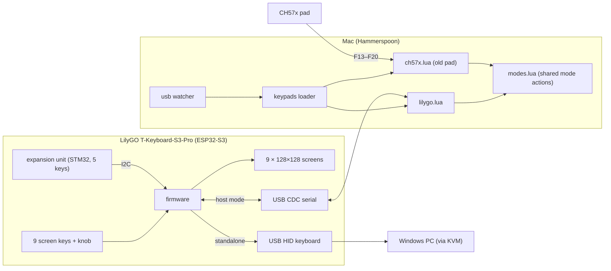

# keypads

**v1.5** — 2026-11-12

One tool for two macro pads:

- the **CH57x 6-key pad** (USB `1189:8890`), carried over from
  `~/git/min-claude-keyboard`;
- the **LilyGO T-Keyboard-S3-Pro** (USB `303a:1001`). It has a main unit
  with 4 screen keys and a knob, plus a magnetic expansion unit with 5
  more screen keys, giving 9 screen keys and a knob in all.

A Mac runs Hammerspoon. It notices which pads are plugged in and drives
each one. The LilyGO also works on its own (for example on the Windows PC
behind the KVM) using profiles built into its firmware.

## Scope

Posture: synthetic-or-public data, no PII, local-only reach, trusted
actors, experiment; stage explore.
Change: feature (new firmware plus Hammerspoon modules, run only by the
owner). Threat depth: D2, because there is a new local command channel
(USB serial) that changes device state.
Reviews: Security Analyst design pass (D2). The others are skipped at
explore and recorded as SKIPPED.

## Requirements (agreed 2026-11-11)

1. One Hammerspoon entry point handles both pads. It enables each pad's
   handling only while that pad is plugged in.
2. **Hybrid LilyGO.** When the Mac says hello over USB serial, the Mac
   owns behaviour and sets the screen labels. With no hello, the device
   runs built-in profiles and sends ordinary keypresses.
3. Standalone profiles are compiled into the firmware. Changing them
   means reflashing.
4. **Mode key.** By default, key 1 on the main unit is Mode. Pressing it turns the
   other 8 screens into a picker: each shows a mode name, and pressing
   one selects it. This works the same on the Mac (Mac modes) and
   standalone (firmware profiles).
5. A WoW profile for the Windows PC. Keys 1–9 send `1`–`9`. In WoW,
   Mode is a chord (hold the knob, tap any key), so all 9 keys are free.
7. **The expansion unit is optional.** The firmware detects whether it is
   attached (1 unit = 4 keys, 2 units = 9 keys), at start-up and while
   running. The main unit alone is fully usable, e.g. when travelling.
   The expansion only adds keys.
6. The KVM passes the LilyGO through as a real USB device (checked
   2026-11-11: its own VID/PID and serial number appear behind the KVM
   hub), so serial works when the KVM is on the Mac.

Out of scope for v1: icons or images on keys, editing bindings on the
device, Wi-Fi or Bluetooth, sharing the current mode between the two
pads, and any Windows host app.

## Design



### Repo layout

```
services/keypads/
  src/firmware/          PlatformIO project for the LilyGO
    src/                 the firmware (env keypads)
    spike/               hardware spike + screen calibration (env spike)
    lib/protocol/        line protocol, image assembly, unpacking (pure C++)
    test/test_protocol/  native tests (env native)
    include/calibration.h  per-screen panel offsets
  src/hammerspoon/       init.lua (loader), lilygo.lua, ch57x.lua,
                         modes.lua (shared modes), faces.lua (key faces)
  src/ch57x/keyboard.yaml  flash config for the old pad (unchanged)
  tools/flash.sh         release the port, flash, take it back
  tools/serial_log.py    read the device's serial output (uv)
```

`~/.hammerspoon/init.lua` has one `dofile` pointing at the loader; the
old repo's line is commented out.

### Detecting pads

The loader uses `hs.usb.watcher` plus a scan at start-up.

- **CH57x (`1189:8890`) present:** enable its F13–F20 hotkeys and Talk
  eventtap (behaviour moved across as-is) and show its menu bar item.
  Disable and hide them on removal.
- **LilyGO (`303a:1001`) present:** open each new `usbmodem` serial port
  and wait for the `HELLO keypads` banner; a port that sends no banner in
  5 s is closed and skipped until it reappears. Its menu bar item
  (`⌨️ 🤖 CLAUDE ⇅`, 🎤 while talking; click to pick a mode) shows only
  while connected.

Each pad keeps its own current mode. Both pads share the mode
definitions in `modes.lua` (Claude, iTerm, Browser, Meet, Apps).

### LilyGO: two states

**Standalone (default after power-up).** The firmware draws each key's
label from the active built-in profile and sends HID keys. One physical
press sends one keystroke, or one held key while the button is held.
There are no timed sequences or repeats (see Threats: game rules).

**Host.** This state starts when the Mac sends `HELLO`. The device stops
sending HID entirely. Keys and the knob are reported over serial, and the
Mac sets the labels. The device returns to standalone (releasing every
key first) if the port closes or no `PING` arrives for 3 s. This covers
a KVM switch, Hammerspoon quitting, or the Mac sleeping.

A key that is physically held across any state change is ignored until it
is released, so it never sends a key-down in the new state.

**Mac-side liveness.** The device answers each `PING` with `PONG`. If the
Mac hears no line for 3 s, or the device sends `HELLO keypads` again, the
Mac releases every key it has synthesised (Talk/Space, Dictation) and
goes back to waiting for the handshake.

**Handshake order.** `303a:1001` is Espressif's default ID, so other
ESP32 boards match it too. Hammerspoon writes nothing to a port until it
has read `HELLO keypads 1` from it.

### Serial protocol (text lines, `\n`-terminated, ≤128 bytes)

| Direction | Line | Meaning |
|---|---|---|
| dev → Mac | `HELLO keypads 1 keys=<4/9> knob=1` | Sent on port open and every 2 s until the Mac replies |
| Mac → dev | `HELLO 1` | Enter host state |
| Mac → dev | `PING` | Keep-alive, every 1 s |
| dev → Mac | `PONG` | Reply to each `PING` (Mac-side liveness) |
| Mac → dev | `MODES Claude,iTerm,Browser,Meet,Apps` | Names for the picker (≤8) |
| Mac → dev | `LABEL <key 1-9> <rrggbb> <text>` | Set one key's label and background |
| dev → Mac | `KEY <1-9> D` / `KEY <1-9> U` | Key down/up (key 1 is handled on the device; see below) |
| dev → Mac | `KNOB <+n/-n>` / `KNOB P D` / `KNOB P U` | Knob turn detents, knob press |
| dev → Mac | `MODE <name>` | The user picked a mode in the picker |
| dev → Mac | `LAYOUT <4/9>` | The expansion was attached or removed; the Mac resends the labels for that layout |
| dev → Mac | `UNITS 0x01 0x02 …` | Unit addresses (after `LAYOUT`) |
| dev → Mac | `INFO psram=… free=… faces=ok/off fs=ok/off` | Memory and storage state, after `HELLO 1` |
| Mac → dev | `FACE <k1-9/m1-8> <name>` | Show saved face `name` on a key, or on mode-picker entry n |
| dev → Mac | `MISSING <name>` | No saved face by that name: the Mac uploads it |
| Mac → dev | `IMG @<name> <bytes>` then `IMD <base64>` lines (≤96 chars) | Upload a face (packed, ≤32,896 bytes) |
| dev → Mac | `SAVED <name>` / `ERR …` | Upload stored in flash, or why not |
| Mac → dev | `LIGHT <mode 0-4> <brightness 0-100> <hue 0-360> <saturation 0-100> <pulse ms 0-9999>` | Key lights: 0 off, 1 normal, 2 colour (optionally breathing), 3/4 the controllers' own effects. The Mac uses 4 (LilyGO demo's flowing colours) |
| Mac → dev | `BACKLIGHT <0-100>` | Screen brightness, percent |
| Mac → dev | `DIM <0/1>` | Dim screens and lights (Mac idle 5 min, locked, or screens asleep) / undim |

Any valid line from the Mac counts as "alive" for the 3 s timeout (a
`PING` can wait behind an upload). Device output never blocks for more
than 10 ms (`setTxTimeoutMs`): with both sides writing, blocking writes
deadlocked.

### Key faces

Key faces are images rendered on the Mac (`faces.lua`): an emoji, or a
short word in the bold system font sized to fit, on a solid background.
They are 128×128 RGB565, packed with a PackBits-style run-length code.
Names are content hashes, so a changed face gets a new name. The device
checks an upload by unpacking it, saves it to LittleFS as `/f/<name>`,
and from then on `FACE` loads it from flash; each face is uploaded once
per device. `LABEL` text remains the fallback when no face is shown. The
Mac sends uploads in slices (24 lines per 20 ms) so it keeps reading
while it writes. Face slots and buffers live in the 8 MB PSRAM
(`board_build.arduino.memory_type = qio_opi`, `BOARD_HAS_PSRAM`).

Key down/up are true events, so on the Mac **Talk can genuinely be
held**. The old pad could not do that for keys with modifiers.

The parser ignores unknown or malformed lines and never acts on a
partial one. Label text is limited to 24 printable ASCII characters;
anything else is dropped.

The Mac parser follows the same rules: whole lines only, a 128-byte cap,
keys 1–9 and knob values in range, and `MODE <name>` looked up in
`modes.lua` (unknown names are ignored and logged).

**No serial command makes the device send a HID key.** The firmware has a
single HID-send function, which refuses in host state. The one exception
is the release-all report sent when entering host state. The serial port
cannot be used to type.

### One unit or two

The firmware probes the expansion unit's I2C address at boot and once a
second after that. The layout is either **4** (main unit: keys 1–4) or
**9** (keys 5–9 on the expansion). When the layout changes, the firmware
releases every key, redraws, and in host state sends `LAYOUT n`. Profiles
and Mac modes each define a 4-key and a 9-key layout. The 4-key layout
must hold the essentials on its own, and the 9-key layout adds to it.

### Mode picker (on the device, both states)

**Opening it.** Each profile or mode sets how the picker opens: the
Mode key (the default: key 9, which always shows the current mode; the
main unit alone has no Mode key, and the Mac picks modes from its menu
bar) or `chord` (hold the knob and tap
any key). WoW uses `chord`. While the knob is held, its
press is held back: it only counts as a press if no key was tapped
before it was released.

**Paging.** If there are more modes than free keys (for example 3 slots
on the 4-key layout), turning the knob pages through them.

Pressing the Mode key shows the list (the Mac's `MODES` with their emoji
faces in host state, the firmware profiles when standalone) on the other
keys. Pressing one selects it. The Mode key again, a knob press, or 5 s
with no input, cancels. In host state the device reports the choice with
`MODE <name>` and the Mac then sends that mode's labels. Standalone, the
last profile is saved to flash (NVS) and restored at power-up.

### Firmware

- PlatformIO, `espressif32@6.5.0` (Arduino 2.0.14), matching LilyGO's
  `arduino-esp32-libs_V2.0.14` branch. Board pins come from their
  `pin_config.h`.
- USB: TinyUSB composite device, HID keyboard (consumer keys for volume)
  plus CDC.
- Screens: Arduino_GFX 1.3.7 (the vendor-pinned version), drawing text
  only. No LVGL.
- Expansion unit: talks to the STM32 over I2C (SDA IO6, SCL IO7), using
  LilyGO's `T-Keyboard-S3-Pro_IIC_Command` example as the reference.
- LEDs: off by default. LilyGO says to keep brightness ≤10 with several
  units attached.

### Standalone profiles (built in)

| Profile | Purpose |
|---|---|
| WoW | Game keys for the Windows PC. Mode = chord. |
| Media | Volume (knob), play/pause, next/prev. A known-good test profile. |

WoW mapping:

| Key | 4-key layout | 9-key layout |
|---|---|---|
| 1–4 | `1`–`4` | `1`–`4` |
| 5–9 | — | `5`–`9` |
| Knob turn / press alone | nothing (v1) | nothing (v1) |

### Mac modes on the LilyGO

These are the same modes as the old pad, with labels on the keys.

Faces are emoji only, except key 8 (text). Changed 2026-11-11 at the
owner's request: Talk on key 1, Mode on the last key. Claude mode
reordered 2026-11-12 (owner's request).

| Key | Every mode | Claude | iTerm | Browser | Meet | Apps |
|---|---|---|---|---|---|---|
| 1 | 🎤 Talk: tap = Enter (Meet: mic), hold = push-to-talk | | | | | |
| 2 | | ⬅️ prev tab | 🧹 Clear | ❌ close tab | 🧹 Clear | 🧹 Clear |
| 3 | | ➡️ next tab | 🪟 pane | 🔙 back | 📷 camera | ✋ Esc |
| 4 | | ✅ Enter | ⬅️ tab | ◀️ tab | ✋ hand | ✅ Enter |
| 5 | | 🪟 next pane | ➡️ tab | ▶️ tab | 💬 captions | ➡️ Tab |
| 6 | | 🧹 Clear | | | | |
| 7 | | 🛑 Stop (Esc) | | | | |
| 8 | knob mode as text: Scroll / Volume / Brightness / Light n / All Screens | | | | | |
| 9 | Mode (emoji of the current mode) | | | | | |

Without the expansion there is no Mode key; modes are picked from the
menu bar. Claude: 🎤 Talk, ⬅️ prev tab, ➡️ next tab, ✅ Enter. Other
modes: keys 1–3 as above, key 4 blank. The knob turns by its knob mode
(Scroll = the mode's up/down) and its press is select.

### Lights, brightness and idle (v1.5)

- **Key lights** run the controllers' effect 2 by default (the flowing
  colours from LilyGO's demo), on both units.
- **Knob mode "Light"** (LilyGO only) sets a pad level 1–10, saved in
  `hs.settings`: screens at level × 10 %, lights at level × 3.
- **Knob mode "All Screens"** moves every Mac display (through
  BetterDisplay's command line, `set -type=Display -brightness=±10% -offset`)
  and the pad level together. The macOS brightness key only changes the
  focused display. BetterDisplay can't set brightness on a display group.
- **Idle:** the Mac sends `DIM 1` when idle (no keyboard, mouse or pad input
  for 5 min), locked, or its screens sleep, and `DIM 0` on the next input
  (checked every second). The device also dims itself after 60 s without
  a Mac and without a key press (e.g. the Mac is asleep). Dimmed: screens
  8 %, lights 3.

## Spike results (2026-11-11)

Hardware facts, measured on our unit (main + one expansion). The firmware
must follow them:

- **Units.** Each unit has its own STM32 controller on one I2C bus
  (SDA 42, SCL 2, 1 MHz): main = `0x01`, expansion = `0x02`. Detecting one
  unit vs two is an address scan. All screens share one SPI bus; a unit
  selects a screen by writing a bitmask to register `0x01`.
- **Controller writes are applied late.** The STM32 only acts on a write
  when the *next* I2C transaction arrives. LilyGO's code hides this with
  a non-stop background scan. Every write must be followed by an empty
  probe to the same address, or the screens never receive anything.
- **Keys are level, not edge.** Register `0x02` returns the bitmask of
  keys currently held (several at once work), so true down/up events
  come from comparing successive reads. Key bit = screen bit. The main
  unit has keys on bits 16/8/4/2, and bit 1 mirrors the knob press
  (which is also on GPIO0). A read takes about 20 ms per unit.
- **Backlight is active-low** (GPIO1): `ledcWrite(1, 0)` means full
  brightness. LilyGO's comments say the opposite.
- **Panels are ST7735** at 4.5 MHz. Each panel needs its own offset
  (`include/calibration.h`, calibrated by hand: col 1–3, row 0–1, no tilt
  needed). LilyGO's row offset of 3 leaves a noise strip at the top.
- **Panel reset.** Hold LCD reset (GPIO38) high and wait >1 s before
  `gfx->begin()`, with every screen selected.
- **Draw speed.** A full-screen draw takes about 80 ms (20 ms select +
  60 ms SPI), so relabelling all 9 takes about 0.75 s. To meet AC 5, the
  firmware redraws only keys whose label changed and draws mode-picker
  labels in a small band rather than full screens. AC 5 is re-measured
  after step 2.
- **Flashing.** The factory firmware has no serial port, so the first
  flash needs the knob held while plugging in (BOOT), then a replug.
  After that, `pio run -t upload` works on its own.

Spike tooling kept: `spike/` (calibration mode: key = pick a screen, knob
= left/right, up/down, tilt) and `tools/serial_log.py`
(`uv run services/keypads/tools/serial_log.py`).

## Delivery order

1. ✅ **Spike: expansion unit**, plus screen calibration.
2. Firmware: standalone state, profiles (WoW, Media), HID, NVS. *Next.*
3. ✅ Firmware: host state and protocol, with native tests (owner asked
   for the Mac side first, so this went before step 2).
4. ✅ Hammerspoon: loader, `ch57x.lua` (moved; not yet tested on the pad),
   `modes.lua`, `lilygo.lua`, emoji key faces, menu bar.
5. WoW profile.

## Acceptance Criteria

1. **Spike.** With the expansion unit attached, all 9 screens show their
   key number, and pressing each key 1–9 and the knob prints the matching
   event on serial (`pio device monitor`).
2. **Detection.** With only the CH57x plugged in, its keys work as before
   and the Hammerspoon console logs no LilyGO activity. With only the
   LilyGO, F13–F20 hotkeys are not bound. With both, both work at once.
   Plugging or unplugging either one takes effect within 2 s without
   reloading Hammerspoon.
3. **Host handover.** With Hammerspoon running, the LilyGO enters host
   state within 3 s of being plugged in, and its screens show the Mac
   mode's labels. While in host state, pressing any key sends no HID
   keystroke (checked in a text editor: nothing is typed).
4. **Fallback.** Quitting Hammerspoon, or switching the KVM to the PC,
   puts the device into standalone within 3 s (no PING) or at once (port
   closed). No key stays held: after a keyboard-viewer check, no
   modifiers or keys are stuck. On the Mac side, killing the device's
   serial traffic while holding Talk (e.g. unplugging it mid-hold)
   releases Space/Dictation within 3 s. A key held across a state change
   sends nothing until it is released and pressed again.
5. **Picker.** Pressing key 1 shows the picker on keys 2–9 within 200 ms.
   Choosing a mode updates every label within 200 ms. Key 1 or 5 s of
   idle cancels and leaves the mode unchanged.
6. **Talk hold.** In Claude mode on the Mac, holding Talk past 0.25 s
   starts push-to-talk and releasing stops it. A tap sends Enter.
7. **Standalone persistence.** After a power cycle, the last chosen
   standalone profile is active.
8. **One press, one key.** In standalone, each key press produces exactly
   one key-down and one key-up (checked with a key-event viewer). Holding
   a key holds that key, with no repeats generated by the device.
9. **Parser robustness.** On both sides (device: PlatformIO native tests;
   Mac: Lua tests of the line parser), lines over 128 bytes, unknown
   commands, out-of-range key numbers, unknown mode names and non-ASCII
   label text are ignored or truncated without a crash or a state change.
   A native test feeds every protocol line in host state and asserts that
   no HID report other than release-all is produced.
10. **Old pad parity.** The old design's acceptance criteria 1–8
    (`min-claude-keyboard/docs/architecture/minikeyboard.md`) still pass
    on the CH57x.
11. **Handshake.** An ESP32 board running other firmware (same
    `303a:1001`) gets nothing written to its port by Hammerspoon.
12. **One or two units.** With only the main unit, everything in AC 3–8
    works using the 4-key layout. Attaching or removing the expansion
    while running switches layout within 2 s, releases every key, and
    (in host state) the Mac relabels all keys.
13. **WoW.** Keys send `1`–`9` (`1`–`4` without the expansion). Holding
    the knob and tapping a key opens the picker and sends no digit. A
    knob press alone sends nothing.

## Design rationale

- **Mac owns behaviour in host state.** All the useful context (front
  app, Claude Code voice, menu bar) lives on the Mac, and changing Lua
  needs no reflash. The device keeps only what must work without the Mac:
  profiles and the picker.
- **The picker lives on the device.** It is one implementation for both
  states. The Mac only supplies names.
- **Serial events, not F-keys, in host state.** Nine keys plus the knob
  would use up F13–F24 and collide with the old pad's keys. Serial gives
  real down/up events, and it means nothing is typed if Hammerspoon isn't
  listening.
- **Profiles compiled in.** This is the owner's choice. It is the
  simplest option for an experiment, with no on-device storage format or
  upload command.
- **Ping timeout as well as port close.** A KVM switch or Mac sleep may
  not close the port cleanly, so the device must not sit in host state
  with dead keys.

## Alternatives considered

- **Logic only on the Mac (dumb device):** rejected because it does not
  work on the Windows PC.
- **Logic only on the device:** rejected because it cannot see the front
  app and push-to-talk is harder.
- **Profiles pushed from the Mac and stored on the device:** more
  flexible, but needs an upload protocol and a storage format. Not chosen
  for v1; the owner prefers reflashing.
- **Wi-Fi/Bluetooth link to the Mac:** not needed, because the KVM passes
  USB through. It would also add a network listener.
- **LVGL for the screens:** LilyGO's demos use it, but it is heavy for
  text labels on 9 screens. Arduino_GFX is enough.
- **ESP-IDF instead of Arduino/PlatformIO:** more control, but LilyGO's
  pin configs and expansion-board example are written for Arduino 2.0.14.

## Open questions / known limitations

- **Expansion unit protocol:** answered by the spike (see Spike
  results).
- **Calibration** is per physical unit. A different expansion unit needs
  the spike's calibration mode run again.
- **WoW bindings** are pending from the owner.
- **Knob press is IO0 (BOOT).** Holding it while plugging in enters the
  bootloader. That is fine, but worth knowing.
- **Port busy while flashing.** Hammerspoon holds the serial port open,
  so use `services/keypads/tools/flash.sh`, which pauses and resumes the
  link. A Hammerspoon reload does not close open serial ports, so the
  loader releases the port in `hs.shutdownCallback`. The `hs` CLI can
  hang; the script wraps it in a 10 s timeout.
- **Expansion position.** Unknown whether a unit's I2C address depends
  on which side it is attached (ours: `0x02`). To test: move it and read
  `UNITS`.
- **Face storage is never cleaned up.** About 3 MB holds 100+ faces.
- **Colours shift slightly** through macOS colour management when faces
  are rendered.
- Each pad keeps its own Talk state, so releasing Talk on one pad does
  not stop a recording started from the other.
- **Colour mode on the expansion.** Our expansion's controller runs
  firmware v1 (register `0x10`; the main unit has v2). v1 can't set hue:
  it is OR-ed into the old value (LilyGO issue #7). Brightness,
  saturation and effect modes work. Fix: flash LilyGO's
  `STM32G030F6P6_Drive_0x02 … V2` hex over SWD (ST-Link; the socket is
  inside the case). Until then, solid colours work on the main unit only,
  which blocks "pulse the colour of a waiting terminal" on the expansion.
- **Hammerspoon hangs (fixed v1.5).** Opening the serial port inside an
  `hs -c` call (resume, or load during a reload) left `hs.ipc`
  "already recursing". Both are now deferred with `hs.timer.doAfter`.
- **Stuck USB after a Mac restart (fixed v1.5).** Behind a powered hub
  (the KVM) the pad stays on while the Mac restarts, and the ESP32-S3's
  built-in USB serial then sent and received nothing; even esptool
  couldn't connect. Only a replug fixed it. The firmware now watches the
  USB start-of-frame counter: if the bus disappears (no frames for 1 s),
  comes back, and no `HELLO 1` arrives within 15 s, it releases D+ for
  200 ms and reboots, which the Mac sees as a replug. At most once per bus
  outage; a pad on a bus that never drops never reboots. Verified 2026-11-13
  by unplugging the hub from the Mac and plugging it back in.
- `hs.serial` needs the port to appear as `/dev/cu.usbmodem*`. Verified:
  it does (`/dev/cu.usbmodem13401`), through the KVM.

## Red Team Review

**Verdict**: SKIPPED — posture: explore (experiment, synthetic data, local only); the security design pass ran at D2 instead.

## Version history

- **v1.5** (2026-11-12): Claude mode reordered (Voice, Tab <, Tab >,
  Enter, Pane, Clear, Stop, knob mode, Mode); main unit alone has no Mode
  key (menu bar picks modes). Key lights, screen brightness, idle dimming,
  knob modes Light and All Screens. Protocol: `LIGHT`, `BACKLIGHT`, `DIM`.
  Incorrect assumptions corrected: assumed both units run the same
  controller firmware (main v2, expansion v1, which can't set hue);
  assumed the brightness key changes every display.

- **v1.4** (2026-11-11): key faces (emoji/text images uploaded once and
  kept in flash), Talk on key 1 and Mode on the last key, Claude mode
  gains pane and tab keys, menu bar item per pad (only while plugged in),
  CH57x pad merged in, flash script.
  Incorrect assumptions corrected: assumed PNG from Hammerspoon would be
  128×128 (it renders at Retina 2×, 16-bit); assumed
  `board_build.memory_type` enables PSRAM (the key is
  `board_build.arduino.memory_type`); assumed blocking serial writes were
  safe (both sides writing deadlocked); assumed only `PING` should count
  as liveness; assumed `hs.reload()` closes serial ports.

- **v1.3** (2026-11-11): spike results recorded.
  Incorrect assumptions corrected: assumed a register write takes effect
  immediately (it waits for the next I2C transaction); assumed the
  backlight was active-high, as LilyGO's comments say; assumed LilyGO's
  panel offsets fit our panels; assumed a full relabel fits in 200 ms
  (it takes about 0.75 s).

- **v1.2** (2026-11-11): the expansion unit is optional and detected
  (4- and 9-key layouts). WoW sends 1–9 and its Mode is a knob chord.
  The picker pages with the knob.
  Incorrect assumptions corrected: assumed the expansion unit would
  always be attached.

- **v1.1** (2026-11-11): Security Analyst conditions applied: PONG and
  Mac-side liveness, banner-before-write handshake, Mac parser rules,
  single HID-send function with a test, keys held across a state change
  ignored.
  Incorrect assumptions corrected: assumed VID/PID uniquely identifies
  the LilyGO. It is Espressif's default.

- **v1** (2026-11-11): first design.
  Incorrect assumptions corrected: assumed the KVM might emulate HID. It
  passes the device through (verified via ioreg). Assumed the LilyGO had
  5 keys on one board. It is 4 + knob on the main unit plus a 5-key
  expansion unit.
