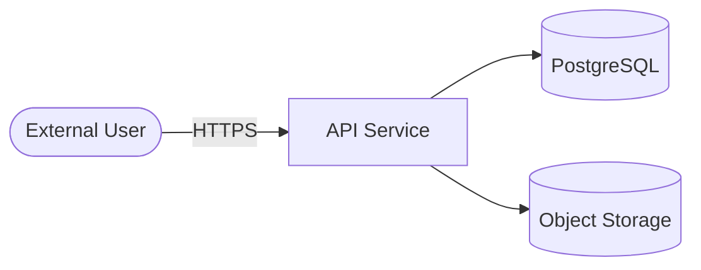

# Threat Model: lilygo-claude

> Last updated: YYYY-MM-DD | Version: v1

## 1. System Context

<!-- What does this system do? Who are its users? What data does it handle? -->
<!-- Include a Mermaid C4Context or flowchart diagram showing trust boundaries -->

## 2. Data Classification

| Data Element | Classification | Storage | Transit | Notes |
|---|---|---|---|---|
| *Example: user email* | SENSITIVE | Postgres (encrypted) | TLS 1.3 | PII |
| *Example: audit logs* | INTERNAL | Postgres | TLS 1.3 | |
| *Example: public datasets* | PUBLIC | S3 | TLS 1.3 | |

Classifications: **PUBLIC** | **INTERNAL** (default) | **SENSITIVE**

## 3. Trust Boundaries

<!-- Where do trust boundaries exist? Mark them on the diagram above. -->
<!-- Consider: external users, internal services, third-party APIs, databases, message queues -->

## 4. Threats (STRIDE)

| Category | Threat | Likelihood | Impact | Mitigation | Status |
|---|---|---|---|---|---|
| **S**poofing | | | | | |
| **T**ampering | | | | | |
| **R**epudiation | | | | | |
| **I**nformation Disclosure | | | | | |
| **D**enial of Service | | | | | |
| **E**levation of Privilege | | | | | |

Likelihood: LOW | MEDIUM | HIGH
Impact: LOW | MEDIUM | HIGH
Status: MITIGATED | ACCEPTED | OPEN

## 5. Security Controls

<!-- Map controls to the threats identified above -->

- **AuthN**: <!-- e.g., OAuth via Keycloak, Cognito -->
- **AuthZ**: <!-- e.g., OpenFGA, role-based -->
- **Encryption at rest**: <!-- e.g., Postgres TDE, S3 SSE -->
- **Encryption in transit**: <!-- e.g., TLS 1.3, mTLS between services -->
- **Input validation**: <!-- e.g., Pydantic models on all endpoints -->
- **Logging**: <!-- e.g., structured logging, auth event logging -->
- **Rate limiting**: <!-- e.g., API gateway, middleware -->

## 6. Supply Chain

- **Base images**: Docker Hardened Images (dhi.io)
- **Dependencies**: Scanned via pip-audit + osv-scanner + guarddog
- **SBOM**: Generated on tagged builds (CycloneDX)
- **CI gates**: Lint, test, audit, plus the GitLab security suite (SAST,
  Secret Detection, Dependency Scanning, Container Scanning where images
  are built)

## 7. Residual Risks

<!-- What risks have been explicitly accepted and why? -->

| Risk | Rationale for Acceptance | Review Date |
|---|---|---|

## Version History

### v1 (YYYY-MM-DD)

Initial threat model.
